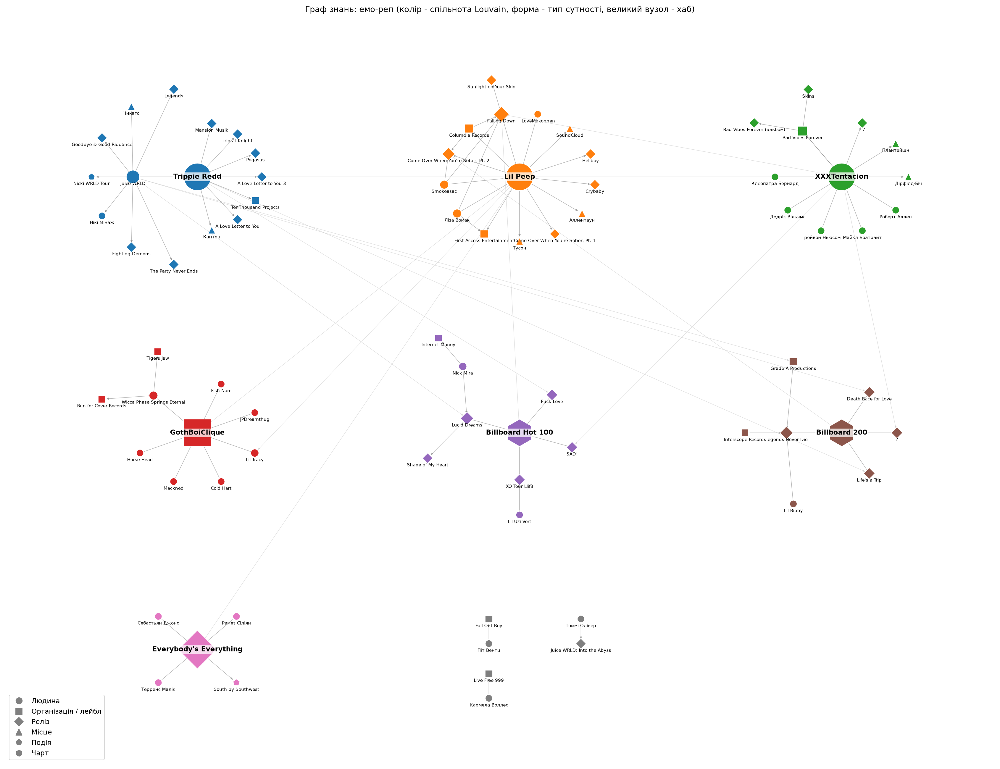

# Лабораторна робота №02: LLM-екстракція знань, векторний пошук та GraphRAG

Дисципліна: «Принципи, методи зв'язування даних у застосуваннях Семантичної павутини».

Виконав: Безруков Андрій, група ІПЗм-11.

Проєкт продовжує тему ЛР-01 (**емо-реп**). У першій лабораторній RDF-граф будувався вручну, тут він збирається автоматично з новинних текстів. Gemini видобуває факти за pydantic-схемою, далі тексти індексуються для семантичного пошуку і порівнюються з keyword-пошуком. На основі фактів будується граф знань, і на «глобальне» запитання є дві відповіді: через GraphRAG і через звичайний vector-RAG.

---

## 1. Предметна область, дані та запитання

**Предметна область** — емо-реп: артисти, релізи, лейбли, колективи, події (смерті, суди, тури) та зв'язки між ними.

**Дані.** 10 новинних текстів українською (≈3 200 слів), один файл = одна новина (`corpus/*.txt`). Тексти — власний переказ новин 2017–2024 років з відкритих джерел (Billboard, Rolling Stone, Pitchfork, BBC News, Вікіпедія).

| Файл | Про що |
| --- | --- |
| `01_lil_peep_death` | Смерть Lil Peep у Тусоні, висновок експертизи |
| `02_lil_peep_legacy` | Посмертний альбом, фільм «Everybody's Everything», позов матері |
| `03_xxxtentacion_death` | Вбивство XXXTentacion, альбоми «17» і «?» |
| `04_xxxtentacion_trial` | Суд над убивцями (2023) |
| `05_juice_wrld_death` | Смерть Juice WRLD, «Lucid Dreams», Grade A / Interscope |
| `06_juice_wrld_legacy` | Фонд Live Free 999, посмертні альбоми, фільм HBO |
| `07_trippie_redd` | Trippie Redd і колаборації з XXXTentacion та Juice WRLD |
| `08_gothboiclique` | Колектив GothBoiClique |
| `09_emo_rap_trend` | Огляд жанру та критика |
| `10_falling_down` | Посмертний дует Lil Peep і XXXTentacion |

Корпус підібраний так, щоб одні й ті самі сутності траплялися в різних новинах (Lil Peep, XXXTentacion, Columbia Records, Billboard Hot 100, Smokeasac). Тому є зв'язки між документами, яких немає в жодній окремій новині.

**Запитання до корпусу** (`questions.md`).

Прості (факт з одного документа):
1. Коли і де помер Lil Peep і що встановила експертиза?
2. Хто спродюсував біт «Lucid Dreams» і яку пісню в ньому семпловано?
3. Яке покарання отримали засуджені за вбивство XXXTentacion?
4. Хто заснував GothBoiClique?

Глобальні (синтез з кількох документів):

5. **Хто є ключовими фігурами емо-репу, як вони пов'язані між собою і які спільні теми та проблеми повторюються в їхніх історіях?** — використовується в п. 4.
6. Які етичні проблеми посмертних релізів обговорюються і на прикладі яких артистів?
7. Які лейбли та продюсери пов'язані з кількома артистами?

---

## 2. Схема сутностей та LLM-екстракція

**Модель:** Gemini через `google-genai`, structured output (`response_mime_type="application/json"`, `response_schema=Extraction`), `temperature=0`. Один запит на одну новину. Модель — `gemini-3.1-flash-lite` (безкоштовний рівень); вона ж використовується для резюме спільнот і відповідей у п. 4.

**Схема** (`schema.py`):

| Тип сутності | Що означає |
| --- | --- |
| `Person` | артист, продюсер, родич |
| `Organization` | лейбл, колектив, компанія, фонд |
| `Release` | альбом, мікстейп, сингл, фільм |
| `Place` | місто, штат, заклад |
| `Event` | смерть, суд, тур, фестиваль |
| `Chart` | Billboard 200, Billboard Hot 100 |

Зв'язки (13): `BORN_IN`, `DIED_IN`, `MEMBER_OF`, `SIGNED_TO`, `RELEASED`, `FEATURED_ON`, `PRODUCED`, `COLLABORATED_WITH`, `SAMPLED`, `CHARTED_ON`, `PARTICIPATED_IN`, `FOUNDED`, `RELATED_TO`.

Атрибути факту: `year` (рік або 0) і `evidence` (дослівне речення з тексту).

```python
class Fact(BaseModel):
    subject: str
    subject_type: EntityType      # Literal["Person", "Organization", ...]
    predicate: RelationType       # Literal["BORN_IN", "RELEASED", ...]
    object: str
    object_type: EntityType
    year: int
    evidence: str
```

Типи зроблені через `Literal`, тому модель не може повернути зв'язок, якого немає в схемі. `evidence` дає змогу автоматично перевірити, чи цитата справді є в тексті (колонка `evidence_in_text` у вибірці).

Після екстракції — нормалізація назв (`canonicalize()` в `extract.py`): регістр, лапки, слова «альбом»/«сингл», словник синонімів (справжні імена → сценічні: «Джарад Гіггінс» → Juice WRLD), прізвище → повне ім'я, видалення дублів.

**Результат:** 111 сирих фактів → **97 фактів** після нормалізації та видалення дублів (`output/facts.json`), 94 сутності. Мінімальна вимога (30 фактів) виконана.

| Новина | Фактів | Сутностей |
| --- | --- | --- |
| 01_lil_peep_death | 10 | 18 |
| 02_lil_peep_legacy | 17 | 17 |
| 03_xxxtentacion_death | 13 | 18 |
| 04_xxxtentacion_trial | 7 | 11 |
| 05_juice_wrld_death | 12 | 20 |
| 06_juice_wrld_legacy | 10 | 19 |
| 07_trippie_redd | 12 | 18 |
| 08_gothboiclique | 12 | 14 |
| 09_emo_rap_trend | 9 | 14 |
| 10_falling_down | 9 | 11 |

Приклади фактів:

| Суб'єкт | Зв'язок | Об'єкт | Рік | Доказ |
| --- | --- | --- | --- | --- |
| XXXTentacion | FOUNDED | Bad Vibes Forever | — | «Музикант заснував власний лейбл Bad Vibes Forever.» |
| Trippie Redd | COLLABORATED_WITH | XXXTentacion | 2017 | «Того ж року вийшов спільний трек «Fuck Love» з XXXTentacion…» |
| SAD! | CHARTED_ON | Billboard Hot 100 | 2018 | «…його пісня «SAD!» з альбому «?» піднялася на першу сходинку Billboard Hot 100.» |
| Wicca Phase Springs Eternal | FOUNDED | GothBoiClique | 2013 | «Серед його засновників називають Wicca Phase Springs Eternal, Cold Hart і Horse Head.» |
| Juice WRLD | PARTICIPATED_IN | Nicki WRLD Tour | 2019 | «У 2019 році Juice WRLD також виступав у турі Nicki WRLD Tour разом із Нікі Мінаж.» |

### Ручна перевірка

20 випадкових фактів (`random.seed(42)`, `verify.py sample`) звірено з текстом (`output/verification.csv`).

**Результат: 20 / 20 коректних (100%).** Вигаданих фактів, вигаданих цитат і неправильно зв'язаних сутностей у вибірці немає.

Неточності, які не рахувались помилками:

| Факт | Що не так |
| --- | --- |
| F014 Smokeasac `COLLABORATED_WITH` Lil Peep | у тексті Smokeasac — продюсер альбому, точніше було б `PRODUCED` → «Come Over When You're Sober, Pt. 2» |
| F018 XXXTentacion `FEATURED_ON` Falling Down | за схемою коректно, але насправді це рівноправний дует |
| F036 SAD! `CHARTED_ON` … 2018 | року в реченні немає, модель вивела його з контексту |
| F012, F065 артист `RELEASED` посмертний альбом | у тексті реліз випустив лейбл; за схемою допустимо |

Типові слабкості моделі: обирає загальний зв'язок (`COLLABORATED_WITH`) там, де можна точніший (`PRODUCED`), і бере рік із контексту, а не з самого речення.

---

## 3. Векторний пошук

**Чанкінг** — власна функція `chunk_document()` у `search.py`: текст ділиться на речення, речення об'єднуються в чанк до ~120 слів, між сусідніми чанками перекриття в 1 речення, на початок кожного чанка додається заголовок новини.

Чому так:
- новини короткі (250–400 слів), один абзац — одна подія; 120 слів — це 1–2 абзаци, достатньо для контексту і без змішування кількох подій;
- речення не розрізаються посередині;
- заголовок потрібен, бо в тексті постійно «він», «музикант», «артист» — без заголовка не зрозуміло, про кого фрагмент.

Результат: **33 чанки**, у середньому 112 слів (мін. 41, макс. 131).

**Ембединги:** `gemini-embedding-001`, розмірність 768, `task_type=RETRIEVAL_DOCUMENT` для чанків і `RETRIEVAL_QUERY` для запитів.
**Сховище:** numpy-масив нормованих векторів (`output/embeddings.npy`), пошук — косинусна подібність (`emb @ q`), функція `VectorStore.search(query, k)`.
**Keyword-пошук:** пошук підрядка та TF-IDF (`sklearn`).

**Порівняння** — ранг першого чанка з правильної новини в топ-5 (`—` = не знайдено). Повний вивід з топ-3 по кожному запиту: `output/search_comparison.md`.

| Запит | Тип | Підрядок | TF-IDF | Вектор |
| --- | --- | --- | --- | --- |
| якого репера вбили під час пограбування | перефразований | — | 4 | **1** |
| музикант втратив свідомість одразу після посадки літака | перефразований | — | 1 | 1 |
| родина загиблого артиста судиться з його менеджерами | перефразований | — | — | **1** |
| XO Tour Llif3 | точна назва | 1 | 1 | 1 |
| Live Free 999 | точна назва | 1 | 1 | 1 |
| Smokeasac | точне ім'я | 1 | 1 | 1 |
| Mackned | точне ім'я | 1 | 1 | **—** |
| 70 фунтів | точне число | 1 | 1 | **5** |
| 50 тисяч доларів | точне число | 1 | 1 | 1 |
| 29 листопада 2024 | точна дата | 1 | 1 | 1 |

**Де виграє семантичний пошук.** Запит «родина загиблого артиста судиться з його менеджерами». У тексті сказано: «мати… подала позов… до компанії, яка займалася менеджментом». Жодне слово запиту не збігається з текстом за формою, тому підрядок і TF-IDF нічого не знаходять, а векторний пошук ставить потрібну новину на 1 місце. Те саме із запитом «якого репера вбили під час пограбування»: TF-IDF знаходить потрібний чанк лише на 4-му місці, бо не бачить, що «вбили» і «вбивство» — одне слово (українська морфологія), а вектор — на 1-му.

**Де програє.** На унікальних назвах (`XO Tour Llif3`, `Live Free 999`, `Smokeasac`) вектор не програв: корпус маленький (33 чанки), а ці назви стоять поруч зі змістовним контекстом. Програш видно на рідкісному імені та числі:

- **`Mackned`** — ім'я учасника GothBoiClique, яке згадується один раз у переліку («Fish Narc, Lil Tracy, Mackned, JPDreamthug та інші»). Підрядок і TF-IDF знаходять чанк на 1 місці, а векторний пошук не знаходить його взагалі в топ-5. Для моделі ембедингів це набір рідкісних токенів без значення, а вектор чанка визначається основним змістом абзацу (історія колективу), а не одним ім'ям у переліку.
- **`70 фунтів`** — потрібний чанк лише на 5-му місці замість 1-го. Ембединг «розуміє», що йдеться про кількість чогось, але не прив'язує запит до конкретного числа, тому вище опиняються інші чанки з числами та вагою.

Числа з ширшим контекстом («50 тисяч доларів», «29 листопада 2024») вектор знайшов, але гарантії тут немає — на відміну від пошуку підрядка, який точний збіг знаходить завжди.

Ще одна різниця, помітна навіть там, де обидва методи на 1 місці: keyword-пошук для точної назви повертає лише чанки, де ця назва є, а векторний завжди повертає топ-5 «схожих» чанків, навіть якщо в них цієї назви немає.

Висновок: найкраще працював би гібридний пошук (keyword + вектор).

---

## 4. Граф знань і GraphRAG

Граф будується з `facts.json` (`networkx.DiGraph`): вузли — сутності з атрибутом `type`, ребра — факти з атрибутами `predicate`, `year`, `evidence`.

**Розмір:** 81 вузол, 94 ребра.

Найбільш зв'язані вузли (степінь): Lil Peep (16), XXXTentacion (15), Trippie Redd (13), Juice WRLD (12), GothBoiClique (8), Falling Down (7), Billboard 200 (5), Billboard Hot 100 (5), Everybody's Everything (5), Come Over When You're Sober, Pt. 2 (4).



Колір — спільнота Louvain, форма — тип сутності, великий вузол — хаб спільноти. Інтерактивна версія: `output/graph.html` (pyvis, при наведенні на ребро видно тип зв'язку і цитату).

**Спільноти:** Louvain (`community_louvain.best_partition`, `random_state=42`) на неорієнтованій копії графа. Модулярність **0.678**, спільнот **7**. Спільноти з 1–2 вузлів приєднуються до спільноти сусіда або збираються в групу «інше».

| № | Назва (від LLM) | Вузлів | Основні сутності | Релевантність (map) |
| --- | --- | --- | --- | --- |
| 0 | Ключові фігури та релізи емо-реп сцени | 16 | Trippie Redd, Juice WRLD, TenThousand Projects, Nicki WRLD Tour | 80 |
| 1 | Творчий шлях та спадщина Lil Peep | 15 | Lil Peep, Smokeasac, Ліза Вомак, Columbia Records, Falling Down | 80 |
| 2 | Спільнота навколо творчості репера XXXTentacion | 12 | XXXTentacion, Bad Vibes Forever, учасники суду, Клеопатра Бернард | 60 |
| 3 | Спільнота GothBoiClique та її учасники | 10 | GothBoiClique, Wicca Phase Springs Eternal, Lil Tracy | 85 |
| 4 | Ключові хіти та творці емо-репу | 9 | Billboard Hot 100, Lucid Dreams, SAD!, Nick Mira, Lil Uzi Vert | 80 |
| 5 | Ключові релізи та лейбли емо-репу | 8 | Billboard 200, Grade A Productions, Interscope, Lil Bibby | 70 |
| 6 | Виробництво та презентація фільму Everybody's Everything | 5 | Everybody's Everything, Терренс Малік, South by Southwest | 30 |

Повні резюме спільнот — `output/community_reports.json` і `output/graphrag_vs_vectorrag.md`.

Louvain розбив граф логічно: по одній спільноті на кожного з трьох «великих» артистів, окремо GothBoiClique і фільм про Lil Peep. Ще дві спільноти зібралися навколо чартів Billboard Hot 100 і Billboard 200: через чарти пов'язані хіти різних артистів, тобто це спільноти «між документами». Trippie Redd і Juice WRLD потрапили в одну спільноту (0) через спільні треки.

### GraphRAG-пайплайн

1. **Резюме спільнот.** Для кожної спільноти в промпт LLM передаються її сутності та зв'язки (разом з ребрами, що ведуть в інші спільноти). Модель повертає `title` і `summary` (`output/community_reports.json`).
2. **Map.** Для кожного резюме LLM оцінює релевантність до запитання (0–100) і виписує тези.
3. **Reduce.** Тези, відсортовані за релевантністю, об'єднуються фінальним запитом у відповідь.

**Vector-RAG:** топ-5 чанків з п. 3 → один запит до LLM, без графа.

### Відповіді на глобальне запитання

**Запитання:** «Хто є ключовими фігурами емо-репу, як вони пов'язані між собою і які спільні теми та проблеми повторюються в їхніх історіях?»

**GraphRAG** (7 резюме → 7 map → 1 reduce; скорочено, повністю — `output/graphrag_vs_vectorrag.md`):

> **Ключові фігури та об'єднання.** Центральною спільнотою жанру є колектив **GothBoiClique**, заснований у 2013 році. До нього входять такі виконавці, як Lil Peep, Lil Tracy, Wicca Phase Springs Eternal, Cold Hart, Horse Head, Fish Narc, Mackned та JPDreamthug. Знаковою для розвитку жанру стала співпраця Lil Peep та Lil Tracy. Окрім GothBoiClique, вагомий внесок у формування емо-репу зробили XXXTentacion, Juice WRLD, Trippie Redd та Lil Uzi Vert.
>
> **Зв'язки та індустрія.** Артисти пов'язані між собою через активну творчу співпрацю та спільних продюсерів. Наприклад, Lil Peep співпрацював з XXXTentacion, iLoveMakonnen та продюсером Smokeasac. Своєю чергою, XXXTentacion мав творчі зв'язки з Trippie Redd. Важливу роль у створенні звучання жанру відіграв продюсер Nick Mira (Internet Money). Комерційний успіх жанру підкріплюється роботою з великими лейблами, такими як Interscope Records та Grade A Productions, а також професійною підтримкою продюсерів, як-от Lil Bibby, який працював над посмертним альбомом Juice WRLD.
>
> **Спільні теми та проблеми.** Історії ключових фігур емо-репу часто мають спільні трагічні риси. Багато артистів, зокрема Lil Peep та XXXTentacion, зіткнулися з передчасною смертю, що стало визначальним моментом у їхніх біографіях. Ці події часто супроводжуються подальшим комерційним успіхом їхніх посмертних релізів (наприклад, «Falling Down» Lil Peep або «Legends Never Die» Juice WRLD).
>
> Творчість цих виконавців характеризується високим рівнем популярності на платформі SoundCloud, що стало трампліном для їхньої кар'єри, а згодом — потраплянням до чартів Billboard Hot 100 та Billboard 200. Таким чином, емо-реп вирізняється не лише специфічним звучанням, а й тісним переплетенням особистих трагедій артистів із їхнім стрімким комерційним злетом.

**Vector-RAG** (топ-5 чанків: `09_emo_rap_trend#0–#3`, `07_trippie_redd#3`; скорочено):

> Емо-реп, що сформувався на платформі SoundCloud у 2015–2017 роках, став визначальним молодіжним жанром кінця 2010-х. До ключових постатей цього напряму відносять Lil Peep, XXXTentacion, Juice WRLD та Trippie Redd. Важливу роль у популяризації звучання також відіграв Lil Uzi Vert, чий сингл «XO Tour Llif3» став одним із гімнів покоління.
>
> Ці артисти тісно пов'язані між собою не лише спільним музичним стилем, що поєднує трепові біти з гітарними мелодіями емо та поп-панку, а й схожими творчими орієнтирами. Музиканти відкрито визнавали вплив рок-гуртів 2000-х: наприклад, Lil Peep будував треки на семплах гітарних партій, а Juice WRLD та Trippie Redd також надихалися рок-музикою та поп-панком. Крім того, Trippie Redd мав спільні роботи з XXXTentacion та Juice WRLD.
>
> Історії цих виконавців об'єднують спільні теми та трагічні проблеми. Тексти пісень емо-реперів були відвертими та зосереджувалися на депресії, тривозі, розставанні та залежності. Оглядачі неодноразово критикували жанр за згадки про рецептурні препарати (Xanax, кодеїн, оксикодон), побоюючись, що це нормалізує їх вживання серед підлітків.
>
> На жаль, життя багатьох лідерів жанру обірвалося передчасно: Lil Peep помер від передозування у 2017 році, XXXTentacion загинув у 2018 році, а Juice WRLD помер від отруєння препаратами у 2019 році. Жоден із них не дожив до 22 років. Ці події змусили музичну індустрію переглянути ставлення до психічного здоров'я артистів, а родини загиблих, зокрема мати Juice WRLD, заснували ініціативи на кшталт фонду Live Free 999.

### Порівняння

| Критерій | GraphRAG | Vector-RAG |
| --- | --- | --- |
| Джерела | усі 7 спільнот (охоплюють усі 10 новин) | 2 новини з 10 (4 з 5 чанків — з оглядової статті 09) |
| Згадані люди | 20+: артисти, учасники GothBoiClique, продюсери Smokeasac, Nick Mira, Lil Bibby, iLoveMakonnen | 5 артистів |
| Лейбли / колективи | GothBoiClique, Bad Vibes Forever, Interscope, Grade A, Internet Money | жодного |
| Конкретні зв'язки | Peep–XXXTentacion, Peep–Lil Tracy, Peep–Smokeasac, XXXTentacion–Trippie Redd, Nick Mira–Internet Money | Trippie Redd–XXXTentacion, Trippie Redd–Juice WRLD |
| Теми та проблеми | передчасні смерті, посмертний комерційний успіх | депресія, залежність, рецептурні препарати, психічне здоров'я, Live Free 999 |
| Узагальнення, яких немає в жодному чанку | «посмертні релізи кількох артистів стали найуспішнішими» (Falling Down + Legends Never Die з різних новин); зв'язок артистів через спільних продюсерів і лейбли | немає: відповідь фактично переказує одну оглядову статтю |

**Висновок порівняння.** Vector-RAG на глобальне запитання зібрав чанки майже з однієї новини — оглядової статті 09, найсхожішої на запитання. Відповідь гладка, але по суті це переказ одного тексту: без продюсерів, лейблів і колективів. GraphRAG пройшов по всіх спільнотах і дав значно ширшу картину зв'язків: хто з ким співпрацював, через яких продюсерів і лейбли. Також він зробив узагальнення, якого немає в жодному чанку: посмертний успіх як спільна риса кількох артистів зібрано з фактів різних новин.

Водночас GraphRAG слабший у «м'яких» темах: депресія, наркотики, психічне здоров'я в його відповіді відсутні. Причина — у схемі: вона описує сутності та зв'язки (хто, що випустив, де помер), а теми текстів у граф не потрапляють. Також GraphRAG дав одне хибне узагальнення: назвав GothBoiClique «центральною спільнотою жанру», бо її резюме отримало найвищу релевантність (85) на етапі map. Оптимальним був би гібрид: граф для структури зв'язків + чанки для тем.

---

## 5. Помилка та виправлення

**Помилка: роздвоєння сутностей у графі.** LLM обробляє кожну новину окремо, тому та сама сутність отримувала різні назви:

```
Lil Peep / Густав Ар / Густав Елайджа Ар
Juice WRLD / Джарад Гіггінс
Come Over When You're Sober, Pt. 2 / альбом «Come Over When You're Sober, Pt. 2»
Hot 100 / Billboard Hot 100
Вомак / Ліза Вомак
```

У графі це давало окремі вузли без зв'язків між собою. Louvain розносив одного артиста по різних спільнотах, а GraphRAG не бачив зв'язків між новинами — тобто пропадала головна перевага графа.

**Виправлення:**
1. У промпті та в описі полів pydantic-схеми — явне правило: артист сценічним ім'ям, релізи без лапок і без слова «альбом», однакова назва в усіх фактах.
2. Функція `canonicalize()`: нормалізований ключ (регістр, лапки, префікси), словник `ALIASES`, заміна прізвища на повне ім'я, якщо збіг однозначний.

```python
ALIASES = {
    "густав ар": "Lil Peep",
    "джарад гіггінс": "Juice WRLD",
    "hot 100": "Billboard Hot 100",
    ...
}
```

**Результат:** 111 сирих фактів → 97 після нормалізації та видалення дублів. Сутності кожного артиста зійшлися в один вузол, тому Lil Peep, XXXTentacion, Trippie Redd і Juice WRLD стали хабами графа (степені 16, 15, 13, 12), а Louvain виділив по спільноті на кожного з них.

**Друга реальна помилка** — порожній `graph.html`:

```
[graph] pyvis пропущено: 'charmap' codec can't encode characters in position 263607-263621: character maps to <undefined>
```

pyvis на Windows записує HTML у системному кодуванні (cp1251/charmap), а не в UTF-8, тому на кирилиці запис обривався, і файл залишався порожнім. Виправлення: HTML генерується через `net.generate_html()` і записується вручну з `encoding="utf-8"`:

```python
html = net.generate_html(notebook=False)
Path(path_html).write_text(html, encoding="utf-8")
```

---

## 6. Висновки

1. Structured output (pydantic-схема + `response_schema`) стабільно повертає валідний JSON: 97 фактів з 10 новин, на вибірці з 20 фактів точність 100%. Основні неточності — надто загальний тип зв'язку та рік із контексту. Поле `evidence` сильно спрощує перевірку.
2. Порівняно з ЛР-01, де граф будувався вручну, тут він збирається автоматично. Головна складність — не сама екстракція, а приведення назв до одного вигляду (entity resolution).
3. Векторний пошук знайшов потрібну новину на 1 місці в усіх перефразованих запитах, тоді як TF-IDF — лише в одному з трьох (через українську морфологію). Keyword-пошук надійніший на точних числах, датах і рідкісних іменах. Оптимально — гібрид.
4. GraphRAG дає повнішу відповідь щодо людей та зв'язків (усі 10 новин проти 2 у vector-RAG) і робить узагальнення з кількох документів. Vector-RAG краще передає теми текстів (депресія, залежність), бо вони не входять у схему графа. Ціна GraphRAG — 15 запитів до LLM (7 резюме + 7 map + 1 reduce) проти одного у vector-RAG.
5. Безкоштовний рівень Gemini часто віддає `503` (модель перевантажена), тому довелося додати повтори з паузою та кеш результатів екстракції по документах.

---

## 7. Код і запуск

### Структура

| Файл | Призначення |
| --- | --- |
| `corpus/` | 10 новин (вхідні дані) |
| `questions.md` | запитання до корпусу |
| `config.py` | шляхи, моделі, параметри чанкінгу, глобальне запитання |
| `llm.py` | виклики Gemini: structured output, текст, ембединги; повтори при 429/503 |
| `schema.py` | pydantic-схема сутностей і зв'язків |
| `extract.py` | п. 2: екстракція фактів, нормалізація назв |
| `verify.py` | п. 2: вибірка 20 фактів і підрахунок точності |
| `search.py` | п. 3: чанкінг, векторний пошук, TF-IDF, порівняння |
| `graph_rag.py` | п. 4: граф, Louvain, візуалізація, GraphRAG vs vector-RAG |
| `pipeline.py` | запуск кроків |
| `output/` | усі результати |

### Встановлення

Python 3.10+.

```bash
python -m venv .venv
.venv\Scripts\activate          # Windows (cmd / PowerShell)
# source .venv/Scripts/activate # Git Bash
pip install -r requirements.txt
```

Створити `.env` за зразком `.env.example` (ключ безкоштовно на [aistudio.google.com](https://aistudio.google.com/apikey)):

```
GEMINI_API_KEY=ваш_ключ
GEMINI_MODEL=gemini-3.1-flash-lite
GEMINI_THINKING=low
```

`.env` у `.gitignore`, у репозиторій не потрапляє.

### Запуск

```bash
python pipeline.py extract   # п.2 -> output/facts.json
python pipeline.py verify    # п.2 -> output/verification.csv (заповнити correct / error_type)
python verify.py score       # точність після ручної перевірки
python pipeline.py search    # п.3 -> output/search_comparison.md
python pipeline.py graph     # п.4 -> graph.png, graph.html, graphrag_vs_vectorrag.md
python graph_rag.py draw     # тільки перемалювати граф, без запитів до LLM
python search.py <запит>     # довільний векторний пошук
```

Результати екстракції кешуються по документах (`output/extract_cache/`), тому після падіння на `503` повторний запуск продовжить з місця зупинки.

### Результати в `output/`

| Файл | Зміст |
| --- | --- |
| `facts.json`, `facts_raw.json`, `entities.json` | факти після та до нормалізації, сутності |
| `verification.csv`, `verification_result.md` | ручна перевірка |
| `chunks.json`, `embeddings.npy` | векторний індекс |
| `search_comparison.md` | порівняння пошуку |
| `graph.png`, `graph.html` | граф знань |
| `community_reports.json` | резюме спільнот |
| `graphrag_vs_vectorrag.md` | відповіді GraphRAG і vector-RAG |
