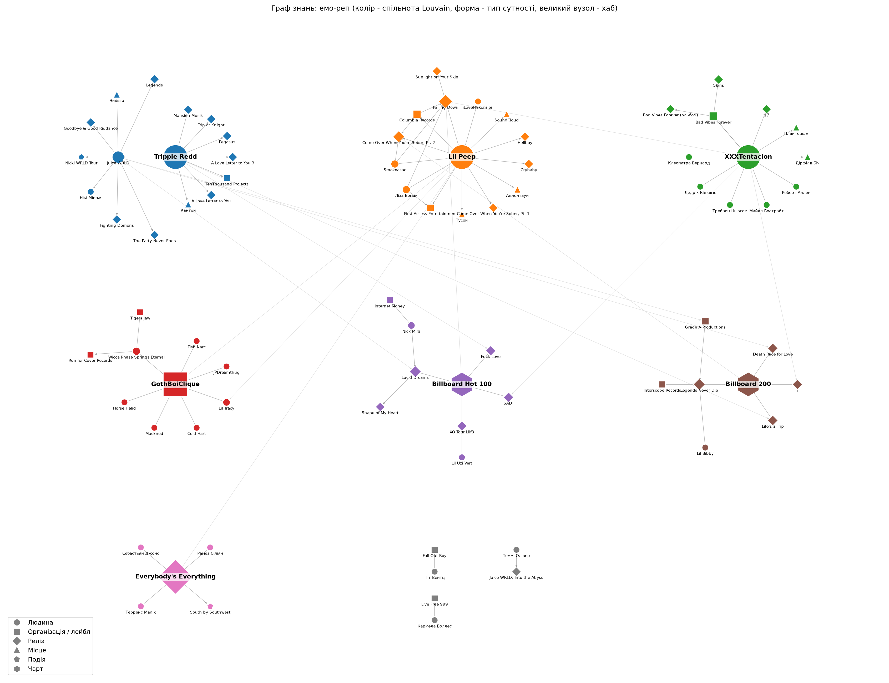

# Лабораторна робота №02
## LLM-екстракція знань, векторний пошук та GraphRAG

Виконав: студент ІПЗм-11 Безруков Андрій

> Позначки ⟨…⟩ заповнюються результатами запуску з папки `output/`.

---

### 1. Предметна область, дані та запитання

**Предметна область:** емо-реп — продовження теми ЛР-01 (там був RDF-граф про артистів, альбоми, лейбли та колектив GothBoiClique). Тут замість таблиць беремо зв'язний текст — новини.

**Корпус:** 10 новинних матеріалів (≈3 200 слів) українською. Тексти — авторський переказ новин 2017–2024 років з відкритих джерел (Billboard, Rolling Stone, Pitchfork, BBC, Вікіпедія):

| № | Документ | Про що |
|---|---|---|
| 01 | lil_peep_death | Смерть Lil Peep у Тусоні, висновок експертизи |
| 02 | lil_peep_legacy | Посмертний альбом, фільм «Everybody's Everything», позов матері |
| 03 | xxxtentacion_death | Вбивство XXXTentacion, альбоми «17» і «?» |
| 04 | xxxtentacion_trial | Суд над убивцями (2023) |
| 05 | juice_wrld_death | Смерть Juice WRLD, «Lucid Dreams», Grade A / Interscope |
| 06 | juice_wrld_legacy | Фонд Live Free 999, посмертні альбоми, фільм HBO |
| 07 | trippie_redd | Trippie Redd і його колаборації з XXXTentacion та Juice WRLD |
| 08 | gothboiclique | Колектив GothBoiClique |
| 09 | emo_rap_trend | Огляд жанру та критика |
| 10 | falling_down | Посмертний дует Lil Peep і XXXTentacion |

Особливість корпусу — одні й ті самі сутності трапляються в різних новинах (Lil Peep, XXXTentacion, Columbia Records, Billboard Hot 100, Smokeasac, Ліза Вомак). Тому є зв'язки між документами, яких не видно в жодній окремій новині.

**Запитання** (`questions.md`):

Прості:
1. Коли і де помер Lil Peep і що встановила експертиза?
2. Хто спродюсував біт «Lucid Dreams» і яку пісню в ньому семпловано?
3. Яке покарання отримали засуджені за вбивство XXXTentacion?
4. Хто заснував GothBoiClique?

Глобальні:
5. Хто є ключовими фігурами емо-репу, як вони пов'язані між собою і які спільні теми та проблеми повторюються в їхніх історіях? *(використано в п.4)*
6. Які етичні проблеми посмертних релізів обговорюються і на прикладі яких артистів?
7. Які лейбли та продюсери пов'язані з кількома артистами?

---

### 2. Схема сутностей і LLM-екстракція

**Модель:** Gemini `gemini-2.5-flash` через `google-genai`, structured output (`response_mime_type="application/json"`, `response_schema=Extraction`), `temperature=0`. Один запит на одну новину.

**Схема (`schema.py`):**

Сутності (6): `Person`, `Organization` (лейбл, колектив, фонд), `Release` (альбом, сингл, мікстейп, фільм), `Place`, `Event`, `Chart`.

Зв'язки (13): `BORN_IN`, `DIED_IN`, `MEMBER_OF`, `SIGNED_TO`, `RELEASED`, `FEATURED_ON`, `PRODUCED`, `COLLABORATED_WITH`, `SAMPLED`, `CHARTED_ON`, `PARTICIPATED_IN`, `FOUNDED`, `RELATED_TO`.

Атрибути факту: `year`, `evidence` (дослівна цитата), `doc_id`.

```python
class Fact(BaseModel):
    subject: str
    subject_type: EntityType
    predicate: RelationType
    object: str
    object_type: EntityType
    year: int
    evidence: str
```

Схема перегукується з ЛР-01: ті самі класи «артист / реліз / лейбл / колектив». Але тепер вони не задаються вручну, а видобуваються з тексту моделлю. `Literal` обмежує типи переліком дозволених значень, а `evidence` дає змогу автоматично перевірити, чи цитата справді є в тексті.

Постобробка (`canonicalize`): нормалізація назв (регістр, лапки, слова «альбом», «сингл»), словник синонімів (справжні імена → сценічні: «Джарад Гіггінс» → Juice WRLD), прізвище → повне ім'я, видалення дублів.

**Результат:** сирих фактів ⟨N_raw⟩, після нормалізації ⟨N⟩ (`output/facts.json`), сутностей ⟨M⟩.

Приклади:
```
⟨3–5 фактів з output/facts.json⟩
```

**Ручна перевірка.** 20 випадкових фактів (`seed=42`, `verify.py sample`), кожен звірено з текстом.

Коректних: ⟨k⟩ / 20 (⟨%⟩).

| Тип помилки | К-сть | Приклад |
|---|---|---|
| hallucination — факт із «власних знань» моделі | ⟨…⟩ | ⟨…⟩ |
| wrong_link — не та пара сутностей | ⟨…⟩ | ⟨…⟩ |
| wrong_type / wrong_direction | ⟨…⟩ | ⟨…⟩ |
| omission — пропуск | ⟨…⟩ | ⟨…⟩ |

На що звернути увагу: `RELEASED` vs `FEATURED_ON` (хто головний артист у «Falling Down»), лейбл як автор релізу, рік сусідньої події, факти з «власних знань» моделі (наприклад, дописаний лейбл, якого немає в тексті).

---

### 3. Векторний пошук

**Чанкінг** (власна функція `chunk_document`): речення об'єднуються в чанк до ~120 слів, перекриття — 1 речення, на початок чанка додається заголовок новини.

Чому так: новини короткі (250–400 слів), один абзац — одна подія. 120 слів — це 1–2 абзаци: достатньо контексту, і чанк не змішує кілька подій. Речення не розрізаються. Заголовок потрібен, бо в тексті часто «він», «музикант», «артист» — без заголовка не зрозуміло, про кого фрагмент. Результат: 33 чанки, в середньому 112 слів.

**Ембединги:** `gemini-embedding-001`, 768 вимірів, `RETRIEVAL_DOCUMENT` для чанків / `RETRIEVAL_QUERY` для запитів.
**Сховище:** numpy-масив нормованих векторів, cosine similarity, функція `VectorStore.search(query, k)`.
**Keyword:** пошук підрядка і TF-IDF (`sklearn`).

**Порівняння** (ранг першого чанка з правильної новини в топ-5, `output/search_comparison.md`):

| Запит | Тип | Підрядок | TF-IDF | Вектор |
|---|---|---|---|---|
| якого репера вбили під час пограбування | перефразований | — | 4 | ⟨…⟩ |
| музикант втратив свідомість одразу після посадки літака | перефразований | — | 1 | ⟨…⟩ |
| родина загиблого артиста судиться з його менеджерами | перефразований | — | — | ⟨…⟩ |
| XO Tour Llif3 | точна назва | 1 | 1 | ⟨…⟩ |
| Live Free 999 | точна назва | 1 | 1 | ⟨…⟩ |
| Smokeasac | точне ім'я | 1 | 1 | ⟨…⟩ |

**Де виграє семантичний пошук:** «родина загиблого артиста судиться з його менеджерами». У тексті написано «мати… подала позов… до компанії, яка займалася менеджментом», тобто жодне слово запиту не збігається за формою. Підрядок і TF-IDF нічого не знаходять, векторний пошук ⟨ставить новину 02 на 1 місце⟩. TF-IDF також не бачить, що «вбили» і «вбивство» — одне слово (морфологія).

**Де програє:** точні назви на кшталт `XO Tour Llif3`, `Smokeasac`. Для ембедингу це рідкісні токени без значення, тому вгорі опиняються чанки «про музику загалом» ⟨приклад: …⟩. Пошук підрядка знаходить їх відразу.

Висновок: найкраще поєднувати обидва методи (гібридний пошук).

---

### 4. Граф знань і GraphRAG

Граф з `facts.json`: `networkx.DiGraph`, вузли — сутності з атрибутом `type`, ребра — факти (`predicate`, `year`, `evidence`).
Розмір: ⟨V⟩ вузлів, ⟨E⟩ ребер.


Інтерактивно: `output/graph.html` (pyvis).

**Спільноти:** Louvain (`community_louvain.best_partition`, `random_state=42`), модулярність ⟨Q⟩, спільнот ⟨C⟩:

⟨таблиця спільнот з output/graphrag_vs_vectorrag.md⟩

Очікувано мають виділитися кластери навколо кожного артиста (Lil Peep + GothBoiClique + Columbia + Ліза Вомак; XXXTentacion + суд + Bad Vibes Forever; Juice WRLD + Grade A + Interscope + Live Free 999; Trippie Redd + TenThousand Projects).

**GraphRAG:**
1. Для кожної спільноти LLM отримує її сутності та зв'язки (разом з ребрами назовні) і пише звіт (`title`, `summary`).
2. **Map:** кожен звіт → оцінка релевантності (0–100) + тези для запитання.
3. **Reduce:** тези, відсортовані за релевантністю → фінальна відповідь.

**Vector-RAG:** топ-5 чанків з п.3 → один запит до LLM.

**Запитання:** «Хто є ключовими фігурами емо-репу, як вони пов'язані між собою і які спільні теми та проблеми повторюються в їхніх історіях?»

**GraphRAG:**
> ⟨з output/graphrag_vs_vectorrag.md⟩

**Vector-RAG:**
> ⟨з output/graphrag_vs_vectorrag.md⟩

**Порівняння:**

| Критерій | GraphRAG | Vector-RAG |
|---|---|---|
| Покриті новини | ⟨…⟩ | ⟨…⟩ (з 5 чанків) |
| Згадані артисти | ⟨…⟩ | ⟨…⟩ |
| Зв'язки між артистами | ⟨…⟩ | ⟨…⟩ |

Пояснення різниці: топ-5 чанків «стягуються» до 2–3 найсхожіших новин, найімовірніше до огляду жанру (09) та однієї-двох новин про смерть. Відповідь буде правильною, але без частини зв'язків. GraphRAG проходить по всіх спільнотах, тому може зібрати те, чого немає в жодному чанку. Наприклад, ланцюжок Trippie Redd ↔ XXXTentacion («Fuck Love») ↔ Lil Peep («Falling Down») і Trippie Redd ↔ Juice WRLD («1400 / 999 Freestyle»): виходить, що всі четверо пов'язані через колаборації. Або узагальнення «посмертно найбільший комерційний успіх отримали всі троє», хоча факти про це розкидані по новинах 02, 03, 06 і 10.

---

### 5. Помилка та виправлення

**Помилка:** роздвоєння сутностей у графі. LLM обробляє кожну новину окремо, тому той самий об'єкт отримував різні назви: `Lil Peep` / `Густав Ар` / `Густав Елайджа Ар`, `Juice WRLD` / `Джарад Гіггінс`, `Come Over When You're Sober, Pt. 2` / `альбом «Come Over When You're Sober, Pt. 2»`, `Hot 100` / `Billboard Hot 100`, `Вомак` / `Ліза Вомак`. У графі це давало окремі вузли без зв'язків. Louvain розносив одного артиста по різних спільнотах, а GraphRAG не бачив зв'язків між новинами.

**Виправлення:**
1. У промпті та в описі полів схеми — явне правило: сценічне ім'я замість справжнього, назва релізу без лапок і без слова «альбом».
2. Функція `canonicalize()`: нормалізація ключа (регістр, лапки, префікси), словник `ALIASES` (справжні імена → сценічні, скорочення лейблів і чартів), прізвище → повне ім'я, якщо збіг однозначний.

Результат: ⟨N_raw⟩ → ⟨N⟩ фактів, вузлів ⟨до⟩ → ⟨після⟩, компонент зв'язності ⟨до⟩ → ⟨після⟩ (`nx.number_weakly_connected_components`).

---

### 6. Висновки

1. Structured output (pydantic-схема + `response_schema`) стабільно повертає валідний JSON, але точність фактів ⟨%⟩, тому вибіркова перевірка обов'язкова. Поле `evidence` суттєво її спрощує.
2. На відміну від ЛР-01, де граф будувався вручну, тут він збирається автоматично з тексту. Головна складність — не сама екстракція, а приведення назв до одного вигляду (entity resolution).
3. Векторний пошук виграє на перефразованих запитах і не залежить від відмінків. Keyword-пошук виграє на точних назвах та іменах. Найкраще — гібрид.
4. GraphRAG дає повнішу відповідь на глобальне запитання, бо збирає інформацію з усіх спільнот і показує зв'язки між артистами з різних новин. Ціна — ⟨2C+1⟩ запитів до LLM проти одного у vector-RAG.

### 7. Репозиторій

⟨посилання⟩
